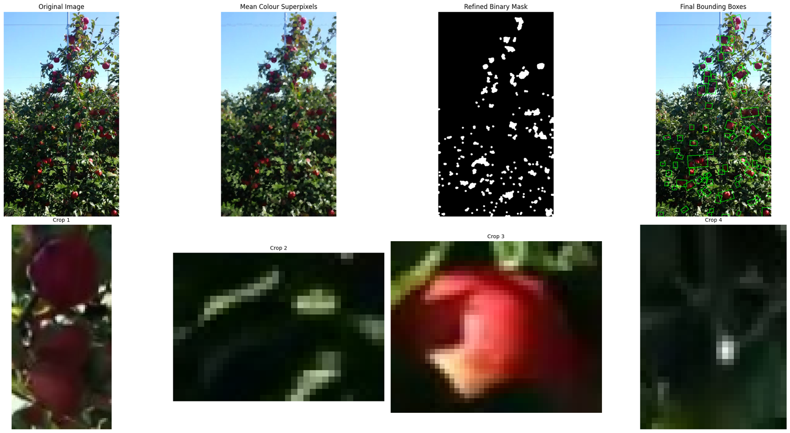
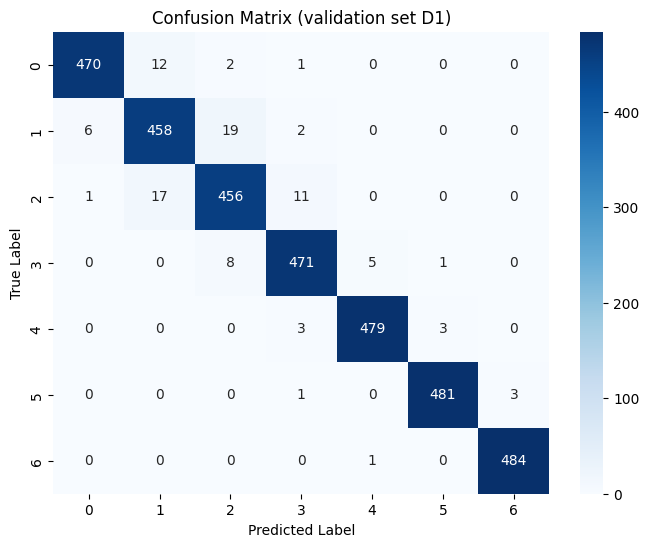
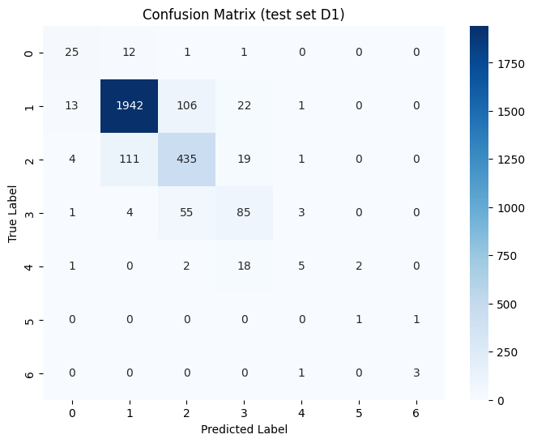
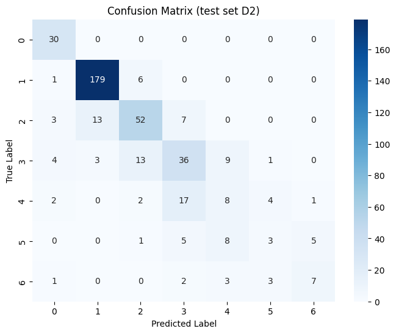
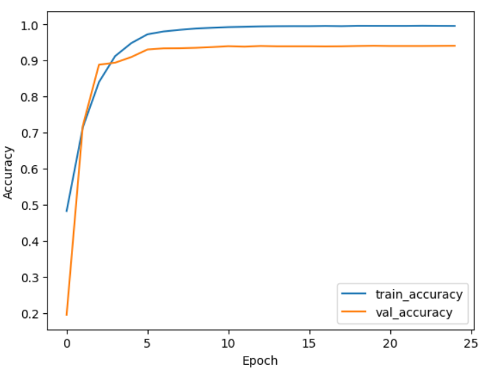
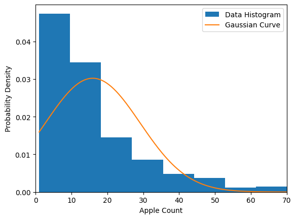
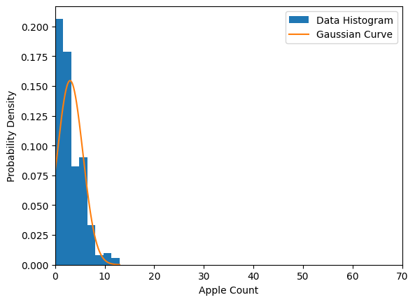

# Apple Counting with Superpixel Segmentation + ResNet50

Counting apples on orchard trees in two stages:

1. **Region proposal (classical CV):** SLIC superpixels in LAB colour space, each modelled as a 3-D Gaussian and classified as apple or background by KL divergence against 30 reference colour clusters. Morphological clean-up then gives rotated bounding boxes and crops.
2. **Count classification (deep learning):** a fine-tuned ResNet50 classifies each crop as 0–6 apples. The per-crop counts are added up to give the count for the whole image.



## Results

| Evaluation | Data | Metric |
|---|---|---|
| CNN, validation | MinneApple counting val (3,395 crops, balanced) | **Macro F1 0.972**, accuracy 97.2% |
| CNN, held-out test | MinneApple counting test (2,875 crops, imbalanced) | Weighted F1 0.867 (macro 0.61) |
| CNN, cross-dataset | Dataset 2 counting subset (429 hand-labelled crops) | Weighted F1 0.720 |
| Full pipeline | Dataset 2 test (313 full-tree images) | MAE 13.1 apples/image |

<p float="left">
  
  
  
</p>

**What the numbers say:**
- The CNN separates counts 0–6 reliably in-distribution, and most of its errors fall between neighbouring classes (1↔2, 2↔3).
- The drop on the MinneApple test split comes mostly from class imbalance, since about 72% of the crops contain a single apple.
- Most of the full-pipeline error comes from Stage 1. The segmentation depends on colour, so under the strong exposure and contrast changes in Dataset 2 it misses apple regions, and the pipeline undercounts as a result. The CNN can reject false-positive crops, but it cannot recover apples that were never proposed.
- The obvious next step is to swap the colour segmentation for a learned instance-segmentation or detection front end.

| Training curves | Count distribution (Dataset 2) |
|---|---|
|  |   |

## Method details

**Segmentation** (`apple_counting/segmentation.py`)
- Pre-processing: 3×3 Gaussian blur, RGB → LAB, then histogram equalisation of the L channel to reduce lighting variation.
- Superpixels: OpenCV SLICO (`region_size = min(H, W)/60`, 5 iterations, connectivity enforced).
- Classification: each superpixel's LAB mean and covariance are compared with the reference clusters (`assets/color_clusters.json`). A superpixel is labelled apple when `KL(sp‖apple) + margin < KL(sp‖background)`.
- Calibration: the reference clusters came from MinneApple training superpixels with more than 85% overlap with the ground-truth mask, grouped by k-means into 15 apple and 15 background clusters.
- Cropping: elliptical 12×12 opening, then contours (area ≥ 150 px), then minimum-area rotated rectangles with 5 px padding, then a perspective warp to an upright crop.

**Classifier** (`apple_counting/model.py`)
- Input: 224×224 RGB, scaled to [0, 1], ImageNet mean/std normalisation.
- Architecture: ResNet50 (ImageNet) → Global Average Pooling → Dense 1024 ReLU → Dropout 0.5 → Dense 512 ReLU → Dropout 0.5 → Dense 7 softmax.
- Training: sparse categorical cross-entropy, batch size 128.
  - Phase 1: the backbone is frozen and only the head is trained (Adam 1e-3, 5 epochs).
  - Phase 2: the whole network is fine-tuned (Adam 1e-4, early stopping on validation accuracy).
- Model selection: ResNet50 was chosen after comparing it with VGG-16 and AlexNet. Variants with BatchNorm in the head, a 4096-unit head, extra augmentation, and a frozen versus unfrozen backbone were also tried; the configuration above scored best.

## Repository layout

```
apple_counting/       segmentation.py, model.py, data.py, metrics.py
train.py              two-phase training on the MinneApple counting split
evaluate.py           per-class metrics + confusion matrix on labelled crops
count_apples.py       full pipeline on one image or a YOLO-labelled folder (MAE)
notebooks/            Colab notebook that runs the scripts end to end
assets/               colour reference clusters + a demo image
figures/              results used in this README
```

## Quick start

```bash
pip install -r requirements.txt
```

Download `best_finetune.h5` (~300 MB) from the [Releases page](../../releases) into `weights/`, then run:

```bash
python count_apples.py --weights weights/best_finetune.h5 --image assets/demo/example_tree.jpg
```

You can also open `notebooks/apple_counting_colab.ipynb` in Colab.

### Reproducing the results

```bash
# Train (MinneApple counting split with train/ and val/)
python train.py --data data/dataset_1/counting --out weights

# CNN evaluation
python evaluate.py --weights weights/best_finetune.h5 --split data/dataset_1/counting/val  --name "MinneApple val"
python evaluate.py --weights weights/best_finetune.h5 --split data/dataset_1/counting/test --name "MinneApple test"
python evaluate.py --weights weights/best_finetune.h5 --split data/dataset_2/d1 data/dataset_2/d2 --name "Dataset 2"

# Full pipeline MAE
python count_apples.py --weights weights/best_finetune.h5 --yolo-split data/roboflow_data/test
```

## Datasets

The datasets are not included in this repository.

- **MinneApple** (Häni, Roy & Isler): counting split with 64,595 training, 3,395 validation and 2,875 test crops, labelled 0–6. Available from the MinneApple project page.
- **Dataset 2**: Roboflow *Apple detection* dataset (CC BY 4.0). Its full-tree test images have YOLO box labels, and a 429-crop counting subset was hand-labelled for this project. The demo image in `assets/demo/` comes from this dataset.

